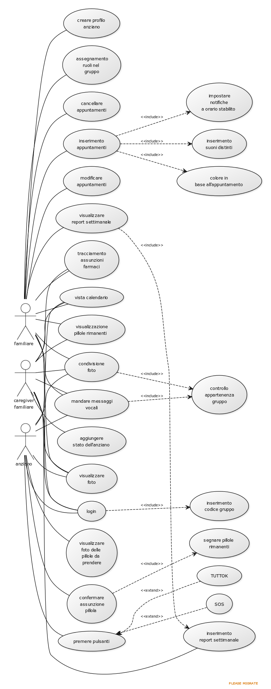

# TUTTOK

> Vicini anche da lontano, con un'interfaccia che parla chiaro.

Applicazione che permette ai familiari di gestire da remoto gli impegni degli anziani con promemoria automatici e un’interfaccia ultra-semplificata.

---

## Il Problema e la Soluzione

I famigliari (figli di genitori anziani o caregiver familiari) spesso, per lavoro o altri motivi, non riescono ad assistere costantemente i loro cari né telefonicamente né via messaggistica. 

TUTTOK è progettata per permettere ai familiari di inserire da remoto promemoria e appuntamenti che arrivano all'anziano in modo semplice e immediato, grazie a un'interfaccia ultra-semplificata.

### Target 
- Figli di anziani
- Anziani poco tecnologici
- Famiglie allargate
- Caregiver famigliari

### Competitors
FamilyWall, Cozi, Medisafe

---
### Tecnologie
- github
- yUML

---

## Requisiti Funzionali

- Creazione, modifica e cancellazione remota di appuntamenti (visite mediche, esami, ecc.)
- Divisione degli appuntamenti per colore (es. sport=verde, medico=rosso) per semplificare il riconoscimento
- Molteplici notifiche configurabili (1 giorno prima, 1 ora prima, 15 minuti prima)
- Suoni distinti per diversi tipi di promemoria (campanella per visite, bip per farmaci)
- Tasti di conferma grandi ("Ho capito") per validare la ricezione dei promemoria
- Modalità "Non Disturbare" automatica durante le ore notturne
- Promemoria farmaci con orari specifici e foto del medicinale
- Tracciamento dell’assunzione del farmaco visibile a figli e badante
- Avviso automatico in base alle scorte rimanenti di pillole
- Pulsante SOS rosso grande per chiamare contatti di emergenza preimpostati
- Messaggi vocali semplici per la comunicazione
- Tasto "TUTTO OK" per segnalare ai familiari che l'anziano sta bene
- Rilevamento inattività a lungo termine dell'anziano nell'app
- Area dedicata alla condivisione di foto per trasmettere serenità
- Gestione multi-familiare dello stesso profilo anziano con ruoli differenziati (Amministratore/Operatore)
- Riassunto settimanale automatico (appuntamenti svolti, farmaci assunti, mancate conferme)
- Vista mensile del calendario condiviso per la pianificazione familiare

---

## Requisiti Non Funzionali

- Layout semplificato con lista chiara di data, ora e tipo di appuntamento
- Ingrandimento automatico del testo per difficoltà visive
- Colori ad alto contrasto per lettura facilitata
- Navigazione tramite schede fisse (Oggi, Domani, Contatti, SOS) senza menu complessi
- Feedback tattile (vibrazioni) e vocale (lettura appuntamenti ad alta voce)
- Icone universali e intuitive al posto del testo ove possibile
- Salvataggio dati nel cloud per accesso multi-dispositivo
- Backup automatico periodico per prevenzione perdita dati

---
## Requisiti di dominio
- avviso in base a quante scorte mancano in base al numero di pilloole
- Esistono ruoli diversi dove l'amministratore può modificare tutto mentre l'operatore può solo segnare i farmaci presi o aggiungere note
- rilevamento in caso di inattivita a lungo termine (anziano che non interagisce con app)
---

## Attori del Sistema

1. Familiare
2. Caregiver Familiare
3. Anziano

---

## User Stories

### FAMILIARE (Amministratore/Coordinatore)

#### Gestione Profilo e Accessi
- Come familiare, voglio creare il profilo dell'anziano e invitare altri familiari, così che possiamo gestire insieme gli impegni.
- Come familiare, voglio assegnare ruoli diversi (amministratore o operatore) agli altri membri, così che ognuno abbia i permessi appropriati.
- Come familiare, voglio visualizzare una vista mensile del calendario condiviso, così che posso coordinare gli impegni dell'anziano.

#### Gestione Appuntamenti Completa
- Come familiare, voglio creare, modificare e cancellare appuntamenti dal mio telefono, così che l'agenda dell'anziano sia sempre aggiornata.
- Come familiare, voglio assegnare colori diversi ai tipi di appuntamento (rosso=medico, verde=sport, blu=esami), così che l'anziano riconosca immediatamente la natura dell'impegno.
- Come familiare, voglio impostare molteplici notifiche per ogni appuntamento (1 giorno prima, 1 ora prima, 15 minuti prima), così che l'anziano non dimentichi nulla.
- Come familiare, voglio associare suoni distinti ai diversi tipi di promemoria (campanella per visite, bip per farmaci), così che l'anziano distingua facilmente gli avvisi.

#### Gestione Farmaci Avanzata
- Come familiare, voglio impostare promemoria farmaci con orari specifici e foto del medicinale, così che l'anziano sappia esattamente cosa prendere.
- Come familiare, voglio monitorare il tracciamento delle assunzioni dei farmaci da parte dell'anziano, così che posso verificare la corretta terapia.
- Come familiare, voglio ricevere avvisi automatici quando le scorte di un farmaco stanno per finire (basato sul numero di pillole rimanenti), così che posso provvedere al rifornimento in tempo.

#### Monitoraggio e Report
- Come familiare, voglio ricevere un riassunto settimanale automatico con appuntamenti svolti, farmaci assunti ed eventuali mancate conferme, così che ho una visione chiara dell'andamento.
- Come familiare, voglio essere avvisato se l'anziano non interagisce con l'app per un periodo prolungato, così che posso verificare che stia tutto bene.
- Come familiare, voglio vedere lo stato "TUTTO OK" quando l'anziano lo conferma, così che so che sta bene senza doverlo chiamare.

#### Gestione Account
- Come familiare, voglio poter chiudere l'account dopo 12 mesi senza costi aggiuntivi, così che non incorro in spese indesiderate se decido di interrompere il servizio.
#### Comunicazione
- Come familiare, voglio inviare messaggi vocali semplici all'anziano, così che posso comunicare in modo facile e immediato.
- Come familiare, voglio condividere foto nell'area dedicata, così che trasmetto sicurezza all'anziano.
---

### CAREGIVER FAMILIARE (Operatore)

#### Operazioni Limitate
- Come caregiver familiare (operatore), voglio segnare i farmaci come assunti dall'anziano, così che posso aiutare nel tracciamento della terapia.
- Come caregiver familiare (operatore), voglio aggiungere note al profilo dell'anziano (es. "oggi si sente stanco"), così che gli altri familiari siano informati.
- Come caregiver familiare (operatore), voglio visualizzare il calendario degli appuntamenti dell'anziano, così che so quando è impegnato.
- Come caregiver familiare (operatore), voglio vedere il riassunto settimanale, così che posso seguire l'andamento anche se non sono l'amministratore principale.

#### Comunicazione
- Come caregiver familiare (operatore), voglio inviare messaggi vocali semplici all'anziano, così che posso comunicare in modo facile e immediato.
- Come caregiver familiare (operatore), voglio condividere foto nell'area dedicata, così che trasmetto sicurezza all'anziano.
---

### ANZIANO (Utente Finale)

#### Interfaccia Semplificata
- Come anziano, voglio vedere pulsanti grandi, icone intuitive e colori ad alto contrasto, così che posso usare l'app facilmente anche se non sono pratico con la tecnologia.
- Come anziano, voglio premere un grande pulsante "Ho capito" per confermare di aver visto il promemoria, così che i familiari sappiano che ho ricevuto l'avviso.
- Come anziano, voglio usare messaggi vocali semplici per rispondere ai familiari, così che non devo scrivere testi lunghi.

#### Sicurezza ed Emergenze
- Come anziano, voglio premere un grande pulsante SOS rosso, così che in caso di pericolo vengano chiamati immediatamente i contatti di emergenza preimpostati.
- Come anziano, voglio premere un grande tasto "TUTTO OK", così che i miei familiari sanno che sto bene senza doverli chiamare.

#### Promemoria Personalizzati
- Come anziano, voglio vedere foto del medicinale nei promemoria farmaci, così che riconosco subito quale pillola prendere.
- Come anziano, voglio sentire suoni diversi per diversi tipi di promemoria (campanella per visite, bip per farmaci), così che capisco immediatamente di cosa si tratta.
- Come anziano, voglio che l'app attivi automaticamente la modalità "Non Disturbare" durante le ore notturne, così che non vengo svegliato da notifiche indesiderate.

#### Benessere Emotivo
- Come anziano, voglio ricevere e guardare foto condivise dai familiari in un'area dedicata, così che mi sento più connesso e provo felicità.

  ---

## Diagramma Use Case (UML)

Di seguito è riportato il diagramma dei casi d'uso che illustra le interazioni tra gli attori e le funzionalità del sistema:

---
## Diagramma Use Case (UML per iscritto)
- [familiare]-(inserimento appuntamenti)
- [familiare]-(condivisione foto)
- [caregiver familiare]-(condivisione foto)
- [anziano]-(condivisione foto)
- (condivisione foto)>(controllo appartenenza gruppo)
- [familiare]-(mandare messaggi vocali)
- (inserimento appuntamenti)>(colore in base all'appuntamento)
- [familiare]-(modificare appuntamenti)
- [familiare]-(inserimento di suoni distinti)
- [familiare]-(visualizzare report settimanale)
- (visualizzare report settimanale)>(inserimento report settimanale)
- [caregiver familiare]-(aggiungere stato dell'anziano)
- [caregiver familiare]-(inserimento report settimanale)
- [familiare]-(tracciamento assunzione farmaci)
- [familiare]-(visualizzazione pillole rimanenti)
- [caregiver familiare]-(visualizzazione pillole rimanenti)
- [caregiver familiare]-(confermare assunzione pillola)
- [familiare]-(visualizzare foto)
- [caregiver familiare]-(tracciamento assunzioni farmaci)
- [caregiver familiare]-(visualizzare foto)
- (confermare assunzione pillola)>(segnare pillole rimanenti)
- [familiare]-(impostare notifiche a orario stabilito)
- [anziano]-(vista calendario)
- [caregiver familiare]-(vista calendario)
- (vista calendario)>(inserimento appuntamenti)
- [familiare]-(vista calendario)
- [familiare]-(creare profilo anziano)
- [familiare]-(assegnamento ruoli nel gruppo) 
- [familiare]-(cancellare appuntamenti)
- [familiare]-(login)
- [caregiver familiare]-(login)
- [anziano]-(login)
- (login)>(inserimento codice gruppo)
- [anziano]-(premere pulsanti di conferma)
- [anziano]-(mandare messaggi vocali)
- [caregiver familiare]-(mandare messaggi vocali)
- (mandare messaggi vocali)> (controllo appartenenza gruppo)
- [anziano]-(premere pulsante SOS)
- [anziano]-(visualizzare foto delle pillole da prendere)
- [anziano]-(visualizzare foto)

